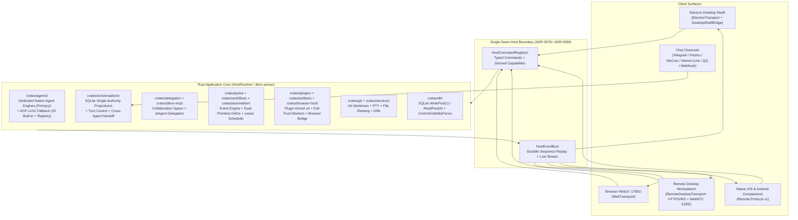

# Dimo System Architecture

Dimo is an all-in-one **Agent-Native Development Platform & Vibe Coding Toolkit** built on a Rust workspace backend and a React 19 + TypeScript frontend. A single Rust execution core (**Dimo Host**, `dimo-server`) powers the Electron desktop app (`electron/` spawning `dimo-server --desktop`), standalone headless daemon (`dimo-server`), browser WebUI, remote desktop workstations (SSH / LAN / E2EE WebRTC), native iOS & Android companions, and bidirectional IM channels.

For domain terminology, read [`CONTEXT.md`](../CONTEXT.md). For the complete documentation map, read [`docs/INDEX.md`](INDEX.md). For permanent architectural decisions, see [`docs/adr/`](adr/).

---

## 1. End-to-End Topology & Single-Seam Host

Only one **Dimo Host** owns a Dimo SQLite data directory at a time ([ADR-0033](adr/0033-shared-application-core-and-versioned-remote-transport.md), [ADR-0054](adr/0054-host-family-distribution-and-client-surfaces.md), [ADR-0078](adr/0078-host-command-registry-single-seam.md), [ADR-0090](adr/0090-electron-thin-shell-and-desktop-sidecar.md)). Every agent process, Git worktree, PTY terminal, Pulse rule, DAG workflow, automation scheduler, plugin worker, and IM channel runs on the Host — clients render projections and issue typed commands over a unified seam.

### Key Architectural Seams

1. **`HostRuntime` & `ApplicationCore`** (`crates/application`, `crates/deployment`, `crates/local-deployment`): Transport-agnostic composition of all domain services. `crates/server` adapts authentication, HTTP/WebSocket framing, and desktop sidecar lifecycle (`--desktop`) onto `HostRuntime`.
2. **Electron Thin Desktop Shell (`electron/`, [ADR-0090](adr/0090-electron-thin-shell-and-desktop-sidecar.md))**: Spawns `dimo-server --desktop` on `127.0.0.1:0` with a per-launch Bearer token passed via env/stdin, `dimo-server-ready` stdout handshake, PID watchdog / Windows Job Object orphan protection, and loopback-only `/api/v1/desktop/*` lifecycle routes. Serves production UI on `dimo-app://localhost` and allowlisted local files on `dimo-asset://`. Embedded browser tabs use Electron `<webview>` bridged to `crates/browser-host` via `ElectronNativeTabs` WebSocket JSON-RPC.
3. **`HostCommandRegistry` & `HostEventBus`** ([ADR-0078](adr/0078-host-command-registry-single-seam.md)): Every product command is registered once in `HostCommandRegistry` (`shared/hostCommands.ts` mirrors the contract on the frontend), and `/api/v1/capabilities` derives directly from it. Native desktop-shell operations (OS dialogs, window controls, clipboard, allowlisted FS, deep links, auto-updater) live in `DesktopShellBridge` (`electron/src/preload/`). All push updates (conversation row-ops, workspace diffs, terminal streams, workflow progress, Pulse events) flow through `HostEventBus`.
4. **Frontend `BackendTransport`** (`frontend/src/lib/transport/`): React components and hooks stay transport-agnostic. At bootstrap, the window binds to a single `ServerProfile` ([ADR-0059](adr/0059-host-identity-and-pairing-invitation.md)) and instantiates:
   - `ElectronTransport` for the local Desktop Host (`dimo-server --desktop`, with automatic snapshot resync on WS `Lagged` gaps);
   - `WebTransport` for browser WebUI (`dimo serve`);
   - `RemoteDesktopTransport` for paired remote Hosts over LAN/SSH/Tailscale HTTPS+WS or NAT-traversing E2EE WebRTC DataChannels (`dimo-webrtc://`).

---

## 2. Dual-Stage Workbench (`frontend/src`)

Dimo pairs two synchronized workspaces over the same live conversation, file, terminal, and preview state:

- **Dockview IDE Stage** ([ADR-0042](adr/0042-conversations-are-first-class-dockview-panels.md), [ADR-0068](adr/0068-workspace-default-surfaces-and-activity.md)): Conversations are first-class Dockview tabs alongside CodeMirror/Monaco editors, 3-pane Git merge & diff views, multi-tab PTY + agent terminals, embedded Electron `<webview>` preview tabs, and plugin App surfaces. Opening a project defaults to its **Project-root workspace** (`use_worktree: false`).
- **Infinite Spatial Canvas Stage** (`@xyflow/react`): One-click toggle (`Alt+Shift+C`) projects up to **24 live interactive windows** onto a pan-and-zoom 2D canvas with 8-direction resize, smart snap guides, radial quick-create menu, minimap, and viewport persistence. Closing or rearranging panels only alters layout — in-flight turns continue uninterrupted on the Host.

Visual styling follows [`DESIGN.md`](../DESIGN.md) (macOS Tahoe two-layer model with opaque Astryx surfaces, tokenized CSS variables in `frontend/src/styles/legacy/index.css`).

---

## 3. Agent Runtime: Dedicated Native Engines First, ACP Fallback (`crates/agents`)

All coding agents execute through `crates/agents` (`AgentRuntime`) under a two-tier integration policy (**Dedicated Agent Engine First, ACP Secondary**; [ADR-0087](adr/0087-dedicated-agent-engine-first-acp-fallback.md), [ADR-0010](adr/0010-agent-runtime-topology.md), [ADR-0035](adr/0035-acp-v2-dual-protocol-session-items.md), [ADR-0060](adr/0060-agent-installs-use-user-environment.md), [`docs/specs/agent-driver-engine.md`](specs/agent-driver-engine.md)):

- **Tier 1 — Dedicated Agent Engine Adapters (Primary)**: Core Coding Agents bind directly to their official SDKs, native protocols (such as `app-server` JSON-RPC and `claude-native-driver.mjs`), and native session/config/auth state. Dedicated engines preserve first-party control-plane fidelity (exact token & Prompt Cache TTL accounting, rate-limit reset timestamps, native steering, coordinated session/git rewind, subagent streams, and native status/quota visibility) and take precedence over generic ACP advertisements.
- **Tier 2 — ACP Compatibility Pipeline (Secondary Fallback)**: Built-in profiles without a dedicated native engine driver, dynamic entries from the **ACP Official Registry**, and user-declared `npx`/`uvx`/binary distributions run through the shared Agent Client Protocol (ACP v1 baseline + v2 negotiated capabilities) pipeline.
- **20 Built-in Agent Profiles** (`BuiltInProfileCatalog::bundled()` in `crates/agents/src/profiles/mod.rs`): Claude Code, Codex, Pi, OpenCode, Grok, Cursor, DeepSeek Harness, Google Antigravity, Cline, OpenClaw, Hermes, CodeBuddy, Kimi Code, Qoder, Kiro CLI, Auggie, TRAE CLI, Command Code, ZCode, and OMP.
- **User-Environment Installation**: Agents install into and resolve from the user's own environment (`PATH`, npm global prefix, `uv tool`, `~/.local/bin`), recorded via verifiable `InstallationLock` entries.
- **Unified Auth & Provider Presets** ([ADR-0063](adr/0063-model-provider-presets-not-cc-switch.md), [ADR-0064](adr/0064-unified-agent-authentication-modes.md), [ADR-0085](adr/0085-modelrouter-is-a-webview-side-provider-source.md), [ADR-0088](adr/0088-built-in-provider-presets.md)): Each profile declares supported auth modes (`Official Subscription`, `Official API`, or `Model Provider Preset`). Built-in provider presets live in the Host; plugins may append catalog templates. Secrets stay in Rust/native config files and never echo to the frontend.
- **Role of `crates/executors`**: Frozen to (1) `ScriptRequest` execution for setup/cleanup/dev-server shell scripts, (2) `BaseCodingAgent` / `ExecutorConfig` profile schemas, and (3) shared `NormalizedEntry` log structures. Coding agents never run through `crates/executors`.

---

## 4. Conversations, SQLite Single-Authority Projections & Cross-Agent Continuation

Conversations persist both control-plane state and user-visible timeline projections in SQLite ([ADR-0044](adr/0044-conversation-control-plane-and-durable-inputs.md), [ADR-0089](adr/0089-conversation-binding-generations-and-history-segments.md), [ADR-0091](adr/0091-sqlite-single-authority-conversation-projection.md)):

- **SQLite Dual-Pool Concurrency (`crates/db`)**: Single-connection `WritePool(1)` serializes `BEGIN IMMEDIATE` transactions with zero write contention; concurrent `ReadPool(4)` (`read_only(true)` + `PRAGMA query_only = ON`) serves readers without blocking; `CommitVisibilityFence` guarantees post-commit WAL visibility for write-then-read sequences.
- **Single-Authority Event & Timeline Projection (`crates/conversations`)**: Substantive streaming deltas persist into `conversation_events` via `StreamingThrottleCoalescer` (400ms Markdown boundary / 800ms idle / 64 KiB cap / non-delta barrier) and `BatchConversationEvent` (`<= 64` events, `<= 1 MiB`), updating `conversation_timeline_rows` incrementally via `DirtyRowMap` and indexing row-level `conversation_fts`. Legacy `.jsonl` transcripts backfill once via `backfill.rs` (`sessions.legacy_jsonl_migrated`) and `session/load` replay probes read SQLite directly.
- **Durable Control Plane**: Tracks revisioned drafts, ordered queued inputs, delayed inputs, in-flight **Turn Steering**, interactive permission/question prompts, atomic checkpoint rewind, **Session Fork** ([ADR-0005](adr/0005-session-fork-copies-events.md)), and deterministic startup recovery (`Completed | Failed | Cancelled | Interrupted`).
- **Cross-Agent Continuation & Deterministic Handoff** ([`docs/specs/cross-agent-continuation.md`](specs/cross-agent-continuation.md)): `conversation_agent_bindings` tracks per-`continuation_key` (`agent_id|provider_instance_id|working_dir`) resume heads; `conversation_handoffs` tracks durable delivery (`planned → sending → delivered | uncertain | cancelled`) using zero-LLM `DeterministicHandoffService` delta packing.

---

## 5. Multi-Agent Collaboration, Pulse Event Automation & Dual-Primitive Workflows

### Collaboration Member Identity {#collaboration-member-identity}

**Collaboration Space** is a built-in Host capability (`Settings → General → Collaboration Space`, enabled by default):

- **Bot (`collaboration_members` / `member_id`)**: A persistent collaborator identity configured with display name, optional persona/role seed, bound Agent profile, and workspace scope. UI copy labels it **助手 / Bot** (`member` in Rust/TS identifiers).
- **Hidden Seat Conversations**: Users interact with bots and rooms rather than raw session IDs. Each bot owns a direct thread (`direct:<member_id>`, `kind: dm`) plus one hidden seat conversation per group (`space` / `kind: group`), backed by an append-only room log (`space_messages`) and per-recipient `DeliveryReceipt` tracking (`queued → processing → replied | passed | timed_out | cancelled`, with derived `failed` / `limit_reached`).

### `&Agent` LLM-Mediated Delegation (`crates/delegation` + `crates/dimo-mcp`)

Typing `&Agent` in the Composer inserts a structured mention ([ADR-0031](adr/0031-llm-mediated-delegation-and-ampersand-agent-mentions.md), [ADR-0065](adr/0065-composer-at-reference-panel.md)). The parent agent invokes `delegate_to_agent` via `dimo-mcp` to spin up an audited, bounded child `DelegatedConversation`, or `create_conversation` for a persistent peer `SpawnedConversation`.

### Pulse Event-Driven Automation, Dual-Primitive Workflows & Scheduled Automations

- **Pulse Event Engine (`crates/pulse`, `packages/pulse-sdk`, [ADR-0092](adr/0092-pulse-event-driven-automation-and-dual-primitive-workflows.md), [`docs/specs/pulse-automation-engine.md`](specs/pulse-automation-engine.md))**: Normalizes GitHub, Jira, Feishu, Custom SDK, and `TemporalSource` (Cron + one-shot timer + `InactivitySlaTracker`) events into `EventEnvelope`, verified by `StandardWebhookGateway` (HMAC + replay window + payload cap) and guarded by 3-layer anti-loop protection (`actor.isSelf`, `hopCount`, `ChainRateBreaker`) plus `enforce_mandate_origin`. Matched rules dispatch to `Session`, `Bot`, `Group`, `User`, or `Workflow` targets.
- **Dual-Primitive DAG Workflows (`crates/workflows`, `crates/dimo-workflow-mcp`, [ADR-0045](adr/0045-workflows-orchestrate-conversation-turns.md))**: `*.dimo-workflow.json` source artifacts compile and publish into immutable `WorkflowDefinition` versions combining ephemeral `SessionStepSpec`, persistent `BotStepSpec` (with `BotMailboxPolicy`), `GroupStageStepSpec`, `UserGateStepSpec`, `BoundedLoopStepSpec`, `WaitForEventStepSpec`, `OutboxActionStepSpec`, and `ConditionBranchStepSpec`, supporting incremental `WorkflowGraphPatch`, breakpoints, `needs_review` safety stops, and checkpoint-verified partial reruns (`DerivedWorkflowRun`).
- **Scheduled Automations (`crates/automation`)**: Single-owner database lease triggers pinned to a Turn or exact published Workflow version, running in isolated Git worktrees by default with 30-day / 10 GiB retention.

---

## 6. Plugin Platform v4 (`crates/plugins`)

Under **Everything is a Plugin** ([ADR-0046](adr/0046-full-stack-plugin-platform-and-isolated-sdk.md), [ADR-0047](adr/0047-product-centric-plugin-package-and-content-model.md), [ADR-0048](adr/0048-full-trust-plugin-execution-model.md), [ADR-0069](adr/0069-everything-is-a-plugin-platform.md)):

- **Zero Official Privilege**: Official plugins (`plugins/*` and `dimo-plugin.json`) use the exact same public `@dimoai/plugin-sdk` (`^2.0.0`), manifest schema, Full-Trust execution model, and **23 contribution kinds** (`L0` Content, `L1` Descriptor UI, `L2` Provider Seams, `L3` Custom Views across host descriptor, Module Federation `2.0`, and iframe App surface `1.0` tracks) as third-party authors — enforced in CI by `pnpm run plugin:no-privilege`.
- **Single-Layer Extension**: Plugins target Host contribution points only; plugins never depend on or expose extension points to other plugins.
- **Activation Generations & Dual Activation Semantics**: Enabling or updating a plugin atomically publishes an immutable `ActivationGeneration` after verifying `RuntimeInstallationLock` probes. UI & Provider contributions take effect immediately; Agent contributions (Skills, MCP, Hooks) apply cleanly to newly created or rebound sessions.

---

## 7. Repository & Workspace Map

### Rust Cargo Workspace (26 Members)

| Crate / Binary | Responsibility |
| --- | --- |
| `crates/server` (`dimo-server`) | Unified Axum HTTP + WebSocket Host binary serving Remote Protocol v1, desktop sidecar mode (`--desktop`), Pulse webhooks (`/api/pulse/*`), static WebUI (`web/`), and host upgrade logic. |
| `crates/application` | Transport-agnostic `ApplicationCore`, `HostRuntime`, and `HostCommandRegistry` use-case facade. |
| `crates/remote-protocol` | Versioned Remote Protocol v1 DTOs, capability bitsets, pairing envelopes, durable attach frames, and OpenAPI/JSON Schema generator. |
| `crates/agents` | Unified `AgentRuntime`: dedicated native Agent engine drivers (primary) + ACP v1/v2 compatibility runtime (secondary), 20 built-in profiles, ACP Registry client, auth/provider projection, and plan/usage probes. |
| `crates/conversations` | SQLite single-authority Turn lifecycle, `StreamingThrottleCoalescer`, `DirtyRowMap` projections, durable input queue, Turn Steering, and deterministic cross-agent handoff. |
| `crates/delegation` & `crates/delegation-proto` | Broker, spawner, Collaboration Space message/receipt engine, and wire protocol for agent-to-agent delegation. |
| `crates/dimo-mcp` (`dimo-mcp`) | Host-managed stdio/HTTP MCP companion exposing delegation, Collaboration Space, Pulse, and `dimo.session-enhance` tools to agent sessions. |
| `crates/pulse` | Event-driven automation engine: `EventEnvelope` bus, `StandardWebhookGateway`, source normalizers, bounded AST filters, 3-layer anti-loop & mandate guards, and `TemporalSource`. |
| `crates/workflows` | Immutable Dual-Primitive DAG `WorkflowDefinition` compiler, checkpointed `WorkflowRun` state machine, `WorkflowGraphPatch`, debug runs, and run subscriptions. |
| `crates/dimo-workflow-mcp` (`dimo-workflow-mcp`) | Host-managed MCP companion adapting `workflow_*` authoring, inspection, and debug tools to `crates/workflows`. |
| `crates/automation` | Single-owner lease scheduler, due-claim transactions, recovery reconciliation, and worktree/disk retention GC. |
| `crates/plugins` | Plugin Kernel v4: package inspector, marketplace/GitHub installer, runtime lock resolver, Full-Trust Node/Python/Rust worker supervisor, and contribution registry. |
| `crates/plugin-sdk` | Rust Worker SDK for authoring native Dimo v4 plugin workers. |
| `crates/tool-runtime` | Deterministic CLI/binary runtime resolution, SHA-256 verification, bounded health probing, and reference-counted installation locks. |
| `crates/artifacts` | File-backed artifact identity tracking and reference-counted `ArtifactPreviewLease` lifecycle. |
| `crates/browser-host` | Embedded browser tab lifecycle, cookie persistence, DOM element inspection, and `ElectronNativeTabs` preview bridge. |
| `crates/git` | Domain-split Git engine (worktrees, diffs, branches, remotes, 3-way conflict resolution, commit stats) over `git2` + CLI fallback. |
| `crates/services` | Workspace orchestration, filesystem watcher, fuzzy file ranking, PR monitoring, chat channels, config, and approvals. |
| `crates/db` | SQLite persistence layer (`WritePool(1)` / `ReadPool(4)` / `CommitVisibilityFence`), SQLx migrations, and offline `.sqlx` query cache. |
| `crates/deployment` & `crates/local-deployment` | Core `Deployment` service trait and local process/PTY/worktree implementation. |
| `crates/executors` | Workspace lifecycle shell scripts (`ScriptRequest`), `BaseCodingAgent` identity/config schemas, and shared log normalization. |
| `crates/review` | Standalone CLI code-review utility. |
| `crates/api-types` & `crates/utils` | Shared wire/API types (`#[derive(TS)]` → `shared/types.ts`) and cross-platform utilities. |

### Frontend, Desktop Shell, Packages, SDK, Plugins & Mobile

| Directory | Responsibility |
| --- | --- |
| `electron/` | Thin Electron desktop shell (`@dimo/electron`), `dimo-server --desktop` sidecar supervisor, `<webview>` browser host bridge, custom protocols, and auto-updater. |
| `frontend/` | React 19 + TypeScript + Vite workbench (Dockview IDE stage, `@xyflow/react` Spatial Canvas, `BackendTransport`, NormalizedConversation, Settings). |
| `shared/` | Generated Rust→TS contracts (`shared/types.ts`) and unified Host command catalog (`shared/hostCommands.ts`). |
| `packages/` | TypeScript toolchain & companion packages: `@dimoai/plugin-sdk` (`plugin-sdk/`), `@dimoai/plugin-cli` (`plugin-cli/`), `@dimo/plugin-contract` (`plugin-contract/`), `pulse-sdk/`, and `dimo-workflow-mcp/`. |
| `sdk/python/` | Python Worker SDK (`dimo-plugin`) for authoring v4 plugin workers in Python. |
| `plugins/` | 15 official full-trust v4 plugins (`ayu-theme`, `browser`, `code-completion`, `computer-use`, `kanban-views`, `notes`, `office`, `plugin-development`, `prompt-enhancer`, `remote-ssh`, `science`, `session-enhance`, `tauri-ui-debugger`, `voice-input`, `workflow-creator`). |
| `npx-cli/` | `dimoai` npm CLI (`dimo serve`, `dimo list/install`, remote Host commands, and `dimo plugin` management). |
| `mobile/ios/` & `mobile/android/` | Native SwiftUI iOS ([ADR-0084](adr/0084-native-swiftui-ios-companion.md)) and Kotlin/Jetpack Compose Android ([ADR-0041](adr/0041-native-kotlin-compose-android-companion.md)) Companion apps over Remote Protocol v1. |
