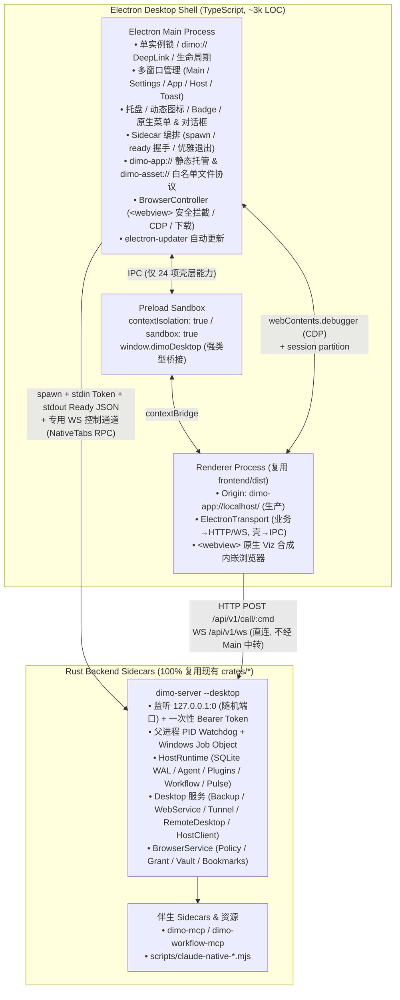

# Dimo 桌面端迁移计划：Tauri v2 → Electron

> 日期：2026-11-20  
> 状态：**M0–M6 全部完成（代码退场、全量门禁与 Windows Release 打包基线已验证；待 CI 5 平台签发与实机双跳演练）**  
> 架构路线：**Electron 薄桌面壳 + Rust `dimo-server` Sidecar + `<webview>` 原生合成浏览器**  
> 关联文档：[Headless Server 部署说明](../deployment/headless-server.md) · [ADR-0033 共享 ApplicationCore 与版本化远程传输](../adr/0033-shared-application-core-and-versioned-remote-transport.md) · [ADR-0078 Host Command Registry 单一接缝](../adr/0078-host-command-registry-single-seam.md) · [ADR-0080 Windows 桌面内存与性能基线](../adr/0080-windows-desktop-memory-and-performance.md)

---

## 1. 背景与已拍板的核心决策

### 1.1 迁移核心动因

Dimo 在 Tauri v2 下的根本瓶颈来自系统原生子 WebView（Windows WebView2 `HWND` / macOS `WKWebView` / Linux `WebKitGTK`）的 **Airspace（空域隔离）与平台分裂** 问题：

1. **无限画布无法正常层叠遮挡**：内嵌浏览器作为 OS 原生子窗口始终强制置顶于主 DOM 之上，无限画布卡片重叠、右键菜单与浮层全靠冻结帧截屏遮罩（`WorkspaceOverlayContext` / `freeze_frame`）维持，交互体验与稳定性长期受限。
2. **几何跟随延迟与生命周期脆弱**：画布拖拽/缩放依赖异步 IPC 同步子窗口边界，易出现错位、掉帧与边界竞态。
3. **三端渲染与调试能力分裂**：WebView2、WKWebView、WebKitGTK 在 CSS、字体、代理、CDP 与 DevTools 能力上差异巨大。

同时，Dimo 的 **~48.1 万行 Rust 核心引擎（`crates/*`）** 与 **React 前端（`frontend/`）** 已高度解耦。因此本次迁移不是重写产品，而是 **“保留 95% 的 Rust 引擎与 99% 的前端页面，仅将 ~5% 的桌面壳从 Tauri 替换为 Electron”**。

### 1.2 已确认的 4 项关键决策（Locked Decisions）

| 编号 | 决策项 | 最终结论 | 工程约束 |
| :---: | :--- | :--- | :--- |
| **D1** | **存量 Tauri 老用户升级路径** | **方案 1：无感自动桥接** | 过渡期（前 2–3 个 Electron 版本）CI 仅构建一套 Electron 安装包，但同时产出 `latest.yml` 系列（供 `electron-updater`）及 minisign 签名的 `latest.json` + `.sig`（供存量 `tauri-plugin-updater` 一键升级覆盖为 Electron 版）。 |
| **D2** | **生产环境主窗口 Origin** | **固定自定义协议 `dimo-app://localhost/`** | 生产环境由 Electron Main 通过 `protocol.handle('dimo-app', ...)` 托管 `frontend/dist`，彻底解耦前端 Origin 与 `dimo-server` 随机空闲端口，确保 `localStorage` / IndexedDB 跨重启 100% 持久化；开发期固定加载 Vite `http://localhost:3000`。 |
| **D3** | **`tauri_inspector` 调试工具处置** | **直接退休，改用 Electron 原生 CDP / Playwright** | M6 随 `src-tauri` 一并删除 `src-tauri/src/commands/tauri_inspector.rs`（591 LOC）及调试期插件依赖，自动化检测统一使用 Electron 内置 `--remote-debugging-port` + Playwright/CDP。 |
| **D4** | **执行顺序与交付节奏** | **M0 → M1 → M2 → M3 → M4 → M5 → M6 分阶段合入** | M0–M4 保持 Tauri 主链路可编译可运行（零中断）；每个阶段拆分为可独立编译、测试与回滚的小 PR；M6 完成三端验收后彻底清除 `src-tauri` 与所有 Tauri 残留。 |

---

## 2. 项目现状深度审计（代码库基线）

### 2.1 代码资产分布与复用率

| 层级 | 路径 | 当前规模 | 迁移处置 |
| :--- | :--- | :--- | :--- |
| **Rust 核心与服务端** | `crates/*`（26 个 crate） | ~481,000 LOC | **100% 保留**，打包为 `dimo-server`、`dimo-mcp`、`dimo-workflow-mcp` |
| **前端 SPA** | `frontend/src` | 仅 **40 个非测试文件**引用 `@tauri-apps` / `__TAURI` | **99% 保留**，M1 收口至 `DesktopShellBridge` |
| **Tauri 桌面壳** | `src-tauri/src`（67 个 `.rs`） | ~26,700 LOC | 拆解消化：~7.8k LOC 非 GUI 业务下沉 `crates/server`；~2.5k LOC `browser_native.rs` 换 Electron `<webview>`；壳层迁至 `electron/` |
| **契约与 CI** | `shared/`、`scripts/`、`.github/workflows/` | 5 目标发布流水线 | 保留 `HOST_COMMANDS` 与 I1–I5 架构门禁，替换打包/签名/发布链路 |

### 2.2 现有 75 条 Tauri IPC 命令精确拆解

来源：`src-tauri/src/lib.rs`（`invoke_handler`）：

| 类别 | 数量 | 模块与代码量 | 迁移去向 |
| :--- | :---: | :--- | :--- |
| **A. 统一业务入口** | 1 | `application_call`（承载 `shared/hostCommands.ts` 数百条 `HOST_COMMANDS`） | **直连 `dimo-server` `POST /api/v1/call/{command}`** |
| **B. 滞留 `src-tauri` 的 5 组非 GUI 业务** | 45 | • `backup_*` (4条, `commands/backup/mod.rs`, 589 LOC)<br>• `web_service` / `host_device` (13条, `commands/web_service.rs`, 977 LOC)<br>• `host_tunnel` (9条, `commands/host_tunnel.rs` + `host_tunnel_relay.rs`, ~2,313 LOC)<br>• `remote_desktop_*` (7条, `remote_desktop.rs` + `commands/remote_desktop.rs`, ~898 LOC)<br>• `host_client_*` (12条, `host_client.rs` + `host_client_sync.rs` + `commands/host_client.rs`, ~3,396 LOC) | **M0 下沉至 `crates/server`**，通过本地桌面受保护路由 `/api/v1/desktop/*` 暴露（严禁向远端配对设备开放） |
| **C. 纯桌面壳与 OS 集成** | 24 | • 生命周期/窗口：`health_check`, `reveal_main_window`, `exit_app`, `evacuate_user_data_before_update`, `set_app_icon`, `update_tray_badge`, `open_settings_window`, `open_app_window`, `get/set_developer_mode`, `open_developer_tools` (11)<br>• 悬浮通知窗：`show/hide/activate_desktop_toast`, `is_main_window_focused`, `desktop_toast_window_ready` (5)<br>• OS 集成：`open_{project,workspace,repo}_in_editor`, `open_external_terminal`, `reveal_in_file_manager`, `allow_preview_asset_scope`, `take_pending_model_router_import` (7)<br>• 插件热开发：`plugin_dev_connection` (1) | **M2–M3 由 Electron Main IPC 实现**（其中 `open_*_in_editor` / `open_external_terminal` / `plugin_dev_connection` 可复用 Rust 侧 `crates/services` 探测逻辑，Electron 直接透传或按需调用） |
| **D. 调试/检测与原生浏览器** | 5 | `tauri_inspector` (4条) + `browser_native.rs`（通过 `HostCapabilityBroker` 注入） | `tauri_inspector` 按 D3 退休；`browser_native.rs`（2,489 LOC）在 M4 替换为 Electron `<webview>` + `BrowserController` |

### 2.3 必须提前补齐的 5 个架构缺口

1. **`HeadlessServer` 与桌面启动后台任务对齐**：`src-tauri/src/lib.rs` 启动时额外执行 `recover_interrupted_agent_operations`、`reconcile_managed_cli_exposures`、`warm_agent_management`、`release_startup_working_set` 以及 `ensure_web_service_autostart`，需在 M0 补入 `crates/server/src/composition.rs` 的桌面启动路径。
2. **类型生成器解耦**：`scripts/run-generate-types.js` 指向 `src-tauri/src/bin/generate_types.rs`（1,144 LOC），M0 需迁至 `crates/server/src/bin/generate_types.rs`（或独立 `crates/typegen`），以解除 `src-tauri` 对类型生成的绑定。
3. **`HostCapabilityBroker` 浏览器注入**：`HeadlessServer::bootstrap_inner` 尚未调用 `.with_browser_host(...)`；M4 将通过 `ElectronNativeTabs`（WS RPC 桥）为桌面模式注入 `BrowserService`。
4. **本地文件预览协议**：`HostHtmlPreview.tsx` 与 `tauriTransport.ts` 依赖 `convertFileSrc` + `allow_preview_asset_scope`；M2 需在 Electron Main 实现带路径白名单校验与 HTTP `Range` 支持的 `dimo-asset://` 协议。
5. **用户数据与前端偏好连续性**：
   - Rust 侧数据目录（`crates/utils/src/assets.rs`）基于 `ProjectDirs::from("app", "dimo", "dimo")`（Windows `%APPDATA%\dimo\dimo\data`、macOS `~/Library/Application Support/app.dimo.dimo`、Linux `$XDG_DATA_HOME/dimo`），与 Tauri 完全无关，**老用户数据库/会话/Worktree/书签/凭据保险库 100% 原地继承**。
   - 前端 35 项核心 UI 偏好（含 `dimo:kanban-canvas` 无限画布布局、主题、字体、缩放、快捷键）已通过 `frontendPreferences.ts` 双向同步至后端，自动恢复。
   - **唯一需要告知用户的差异**：内嵌浏览器中的第三方网站 Cookies/登录态无法跨 WebView2/WKWebView 与 Chromium 解密复用，升级后需重新登录一次外部网站。

---

## 3. 目标架构设计

### 3.1 进程拓扑与通信边界



### 3.2 Sidecar 生命周期与防孤儿进程契约

1. **启动握手**：
   - Electron Main 生成 32 字节加密随机 `desktopToken`，通过环境变量（或管道 stdin）传给 `dimo-server --desktop --parent-pid <pid> --listen 127.0.0.1:0 --app-version <ver> --resources-dir <dir>`（绝不写入命令行参数）。
   - `dimo-server` 完成绑定后向 stdout 输出单行 JSON：
     ```json
     {"type":"dimo-server-ready","listen_addr":"127.0.0.1:54321","pid":12345,"protocol_version":"1"}
     ```
   - Main 进程并行创建隐藏/骨架主窗口与拉起 `dimo-server`，收到 `ready` 后通知 `ElectronTransport` 建立连接；若启动失败（端口/DB 异常），在窗口中展示内置诊断与日志导出页。
2. **优雅关闭与防僵尸**：
   - 正常退出：Electron `before-quit` 调用 `POST /api/v1/desktop/shutdown`（超时 5 秒），`dimo-server` 停止自动化/入站任务、清理 `dimo-mcp` / `dimo-workflow-mcp`、执行 SQLite WAL checkpoint 后退出。
   - 异常崩溃保护：
     - **Windows**：Electron Main 将 `dimo-server` 加入 `JOB_OBJECT_LIMIT_KILL_ON_JOB_CLOSE`（或 `dimo-server` 使用 `OpenProcess` + `WaitForSingleObject` 监听父 PID 退出）。
     - **macOS / Linux**：`dimo-server` 监听 stdin EOF（Main 保持 stdin 管道打开），Main 一旦崩溃 OS 立即关闭管道，`dimo-server` 1 秒内触发优雅自停并退出。
3. **安全基线**：
   - 所有业务窗口强制 `contextIsolation: true`、`nodeIntegration: false`、`sandbox: true`。
   - `dimo-server` 的 `enforce_origin` 中间件仅放行 `dimo-app://localhost`（生产）与 `http://localhost:3000` / `http://127.0.0.1:3000`（开发）。
   - `/api/v1/desktop/*` 仅校验本次启动生成的 `desktopToken` 且拒绝非 loopback 来源，绝不暴露给局域网或远程配对设备。

### 3.3 目标目录结构

```text
Dimo/
├── crates/
│   ├── server/
│   │   └── src/
│   │       ├── bin/
│   │       │   ├── dimo-server.rs         # 新增 --desktop / watchdog / shutdown
│   │       │   └── generate_types.rs      # 从 src-tauri 迁入
│   │       ├── desktop/                   # M0 从 src-tauri 迁入的 5 组业务模块（均 ≤ 1,500 LOC）
│   │       │   ├── mod.rs                 # /api/v1/desktop/* 路由与本地 Token 鉴权
│   │       │   ├── backup.rs
│   │       │   ├── web_service.rs
│   │       │   ├── host_tunnel/
│   │       │   ├── remote_desktop.rs
│   │       │   └── host_client/           # 拆分为 mod / store / discovery / sync / updates
│   │       └── browser_bridge.rs          # M4: ElectronNativeTabs (实现 browser_host::NativeTabs)
│   └── ... (其余 25 个 crate 不变)
├── electron/                              # M2 新增 pnpm workspace 子包
│   ├── package.json
│   ├── electron-builder.yml               # 5 平台打包/签名/公证/更新配置
│   ├── tsup.config.ts                     # 编译 main / preload
│   └── src/
│       ├── main/
│       │   ├── index.ts                   # 启动入口、单实例、dimo:// DeepLink
│       │   ├── sidecar.ts                 # dimo-server 守护、握手、崩溃重试、优雅退出
│       │   ├── windows.ts                 # Main / Settings / App / Host / DesktopToast
│       │   ├── chrome.ts                  # 托盘、动态图标、Badge、原生菜单、DevMode
│       │   ├── protocol.ts                # dimo-app:// 与 dimo-asset:// (含 Range)
│       │   ├── osBridge.ts                # 对话框、Reveal、外链、文件系统写入
│       │   ├── updater.ts                 # electron-updater 生命周期与更新前关停钩子
│       │   ├── ipc.ts                     # ipcMain.handle 注册总表
│       │   └── browser/
│       │       ├── controller.ts          # <webview> 安全拦截、会话隔离、下载、弹窗
│       │       ├── cdp.ts                 # webContents.debugger (截图/设备仿真/Eval/Pick)
│       │       └── nativeTabsRpc.ts       # 对接 dimo-server 的 WS JSON-RPC 客户端
│       └── preload/
│           ├── index.ts                   # contextBridge -> window.dimoDesktop
│           └── browserGuest.ts            # 极简 guest preload（Pick Element 选区支持）
├── frontend/
│   └── src/lib/
│       ├── desktopShell/                  # M1 新增统一桌面壳抽象层
│       │   ├── types.ts
│       │   ├── index.ts
│       │   ├── tauriShellBridge.ts        # M1–M5 过渡适配器，M6 删除
│       │   └── electronShellBridge.ts     # M2 新增 Electron 适配器
│       └── transport/
│           └── electronTransport.ts       # M2 新增（复用 WebTransport + 壳层 IPC）
└── scripts/                               # M5 改造 sidecar 打包/签名/双清单发布脚本；M6 清理 tauri-*
```

---

## 4. 内嵌浏览器与无限画布重构设计（M4 核心）

### 4.1 架构对比与选型确认

- **选型**：使用 Electron **`<webview>`**（而非 `WebContentsView`）。原因：`WebContentsView` 仍是顶层独立合成视图，无法参与无限画布 DOM 的 `z-index` 层叠与 CSS `transform: scale()`；`<webview>` 作为 Chromium OOPIF/Viz 合成节点，原生支持圆角裁剪、阴影、多卡片自由遮挡、缩放跟随与 React 卸载自动销毁。
- **彻底删除的技术债**：迁移完成后删除 `src-tauri/src/browser_native.rs`（2,489 LOC）、`WorkspaceOverlayContext` 中的 `NativeSurfaceOcclusionHold` 冻结帧机制、`overlayCoversSurface`、`canvasLayerCoversBrowser`、`snapBrowserSurfaceRect` 及复杂的 HWND 存活缓存。

### 4.2 Agent 浏览器自动化零损失：`NativeTabs` WS RPC 桥

`crates/browser-host` 已将所有策略、授权（`AgentGrant`）、站点规则（`HostRule`）、Eval 审批、书签/历史/凭据保险库与 DOM 快照提取封装在 `BrowserService` 中，仅依赖 `NativeTabs` trait 与真实页面交互：

```mermaid
sequenceDiagram
    participant Agent as Agent / MCP
    participant Srv as dimo-server (BrowserService)
    participant Bridge as ElectronNativeTabs (WS RPC)
    participant Main as Electron Main (BrowserController)
    participant WV as Renderer (&lt;webview&gt;)

    Agent->>Srv: browser.snapshot / eval / capture / click
    Srv->>Srv: 校验 Grant / HostRule / EvalConsent
    Srv->>Bridge: NativeTabs::{eval, capture_png, navigate, ...}
    Bridge->>Main: JSON-RPC { id, method, tabId, params }
    Main->>WV: webContents API / webContents.debugger (CDP)
    WV-->>Main: result / PNG Buffer / 事件
    Main-->>Bridge: JSON-RPC response / event push
    Bridge-->>Srv: Result<T>
    Srv-->>Agent: 结构化响应
```

| `NativeTabs` 接口 | Electron 实现方式 |
| :--- | :--- |
| `open` / `close` | 同步 Renderer 挂载/卸载 `<webview>`；Main 在 `web-contents-created` 绑定 `tabId <-> webContentsId` |
| `navigate` / `go_back` / `go_forward` / `reload` / `stop` / `current_url` | `webContents.loadURL` / `navigationHistory.goBack()` / `reload()` / `stop()` / `getURL()` |
| `set_bounds` / `freeze_frame` | **No-op**（Chromium Viz 原生合成裁剪，无需坐标同步与冻结帧） |
| `eval` / `inject` | `webContents.executeJavaScript` 或 CDP `Runtime.evaluate` |
| `capture_png` | `webContents.capturePage()` 或 CDP `Page.captureScreenshot`（支持被遮挡标签页截屏） |
| `set_zoom` / `set_device` | `webContents.setZoomFactor` + CDP `Emulation.setDeviceMetricsOverride` / `setUserAgentOverride` |
| `open_devtools` / `find` | `webContents.openDevTools({ mode: 'detach' })` / 原生 `webContents.findInPage` |
| Profile 与 Proxy (`clear_profile` / `remove_profile` / `reset_all`) | `partition="persist:dimo-browser-<profile_id>"` + `session.fromPartition(p).clearStorageData()` / `setProxy()` |
| 下载 / 弹窗 / Console | `session.on('will-download')`、`webContents.setWindowOpenHandler`、`webContents.on('console-message')` 实时推回 `BrowserService` |

### 4.3 无限画布专项工程保障

1. **缩放命中精度验证（M4 首日原型）**：实测 `<webview>` 在画布 `scale(0.25)` ~ `scale(2.0)` 下的鼠标命中坐标、滚轮事件、中文 IME 与 HiDPI 清晰度；必要时联动 `setZoomFactor` 或对非活跃缩放态应用平滑策略。
2. **多网页内存治理**：在无限画布存在大量浏览器卡片时，对长时间不可见（视口外且无音频/Agent 活跃任务）的 `<webview>` 支持按策略休眠/释放渲染进程，保留快照与 URL 状态，点击或进入视口自动唤醒，严格控制内存水位。

---

## 5. 分阶段详细执行计划（M0 – M6）

> **工程规范**：遵循项目 Maiden 原则——单文件不超过 1,500 行、单一事实来源、不增加冗余治理门禁、所有阶段先保构建与测试全绿再推进下一步。

### M0：后端收口至 `crates/server` 与 `dimo-server --desktop`（1.5–2 周）

**目标**：让 `dimo-server` 具备 100% 桌面后端能力，彻底解除业务模块与类型生成对 `src-tauri` 的依赖。

#### PR 切片与任务清单

- **PR M0-1：迁出类型生成器 `generate_types`**
  - [ ] 将 `src-tauri/src/bin/generate_types.rs` 迁移至 `crates/server/src/bin/generate_types.rs`（移除任何 `src-tauri` 私有类型引用，必要 DTO 提升至 `crates/api-types` 或 `crates/server`）。
  - [ ] 更新 `scripts/run-generate-types.js`（指定 `-p server --bin generate_types`）。
  - [ ] 验证：`pnpm run generate-types -- --check` 零 diff。

- **PR M0-2：`dimo-server --desktop` 模式与生命周期保障**
  - [ ] 扩展 `crates/server/src/bin/dimo-server.rs`：新增 `--desktop`、`--parent-pid`、`--app-version`、`--resources-dir`、`--token-from-env` / stdin Token 读取、`127.0.0.1:0` 动态绑定。
  - [ ] 实现 stdout 结构化 `dimo-server-ready` 握手输出。
  - [ ] 实现父进程存活 Watchdog（Windows Job Object / `OpenProcess` Wait；Unix stdin EOF）与 `POST /api/v1/desktop/shutdown` 优雅关停端点（含 SQLite WAL checkpoint 与伴生 MCP 进程清理）。
  - [ ] 在 `crates/server/src/composition.rs` 的桌面启动分支补齐：`recover_interrupted_agent_operations`、`reconcile_managed_cli_exposures`、`warm_agent_management`、`release_startup_working_set`。
  - [ ] 在 `crates/server/src/runtime.rs` 的 `enforce_origin` 白名单中放行 `dimo-app://localhost`。

- **PR M0-3：迁出 5 组非 GUI 业务模块至 `crates/server/src/desktop/`**
  - [ ] `backup.rs`（原 `commands/backup/mod.rs`）：进度事件改发 `HostEventBus`（频道 `dimo://backup-progress`）。
  - [ ] `web_service.rs`（原 `commands/web_service.rs`）：统一由 `HostRuntime` 管理启停与配对，补齐启动 `ensure_web_service_autostart`。
  - [ ] `host_tunnel/`（原 `commands/host_tunnel.rs` + `host_tunnel_relay.rs`）：拆分保持单文件 < 1,200 行。
  - [ ] `remote_desktop.rs`（原 `remote_desktop.rs` + `commands/remote_desktop.rs`）：通过 `HostEventBus` 推送远端订阅事件。
  - [ ] `host_client/`（原 `host_client.rs` 2,065 LOC + `host_client_sync.rs` + `commands/host_client.rs`）：拆分为 `mod.rs` / `store.rs` / `discovery.rs` / `sync.rs` / `updates.rs`，暴露 `POST /api/v1/desktop/window-destroyed` 清理窗口绑定。
  - [ ] 将 `plugin_dev_server`、`settings_watcher`、`crash_reports` 与日志轮转收口至 `crates/server`。
  - [ ] `src-tauri` 侧的 45 条命令改为薄转发到 `crates/server::desktop::*`（保持过渡期 Tauri 零回归）。

#### M0 退出门禁
- `cargo test -p server` 全绿（新增 `dimo-server --desktop` 握手、Origin 校验、本地 Token 鉴权、父进程退出自停集成测试）。
- `pnpm run generate-types -- --check` 与 `pnpm run arch:check` 全部通过。
- 现有 Tauri 版构建与启动无回归。

---

### M1：前端桌面壳抽象层 `DesktopShellBridge`（1 周）

**目标**：在不切 Electron 的前提下，将 40 个前端文件与 `@tauri-apps/*` / `__TAURI` 完全解耦。

#### PR 切片与任务清单

- **PR M1-1：建立 `frontend/src/lib/desktopShell/` 契约与 `tauriShellBridge.ts`**
  - [ ] 定义 `DesktopShellBridge` 接口（`kind`、`getAppVersion`、`getWindowLabel`、`window.*`、`dialog.*`、`fs.*`、`shell.*`、`invokeShell`、`listenShell`、`emitShell`、`updater.*`）。
  - [ ] 实现 `tauriShellBridge.ts` 并通过 `getDesktopShell()` 自动探测运行时（优先 `window.dimoDesktop`，其次 `__TAURI_INTERNALS__`）。
  - [ ] 更新 `frontend/src/utils/platform.ts`，使 `isDesktop()` 同时识别 Electron 与 Tauri。

- **PR M1-2：替换全前端 40 个文件的直接 Tauri 依赖**
  - [ ] 窗口与标题栏：`WindowControls.tsx`、`AppTitleBar.tsx`、`revealDesktopWindow.ts`、`uiZoom.ts`、`syncSettingsWindowTitle.ts`、`FocusConversationListener.tsx`。
  - [ ] 文件/对话框/外链/预览：`hostFs.ts`、`previewMediaActions.ts`、`saveTextFile.ts`、`exportProjectConversationPack.ts`、`useOpenLink.ts`、`HostHtmlPreview.tsx`、`openExternal.ts`、`CrashReportDialog.tsx`、`WorkspaceZeroProjectStage.tsx`、`OnboardingProjects.tsx`、`ProductPlugins.tsx` 等全部剩余文件。
  - [ ] 自动更新：`appUpdate/check.ts`、`UpdateAvailableBadge.tsx`、`useRemoteHostReleaseUpdateToast.ts`。
  - [ ] 拖拽区双兼容：在 5 处 `data-tauri-drag-region` 同步添加 `.dimo-window-drag`（CSS `-webkit-app-region: drag`，交互元素 `no-drag`）。

#### M1 退出门禁
- 全局搜索 `frontend/src`（排除测试与 `tauriShellBridge.ts` / `tauriTransport.ts` / `tauriApi.ts`）：`@tauri-apps` 与 `__TAURI` 引用数 **= 0**。
- `pnpm --filter frontend test` 与 `pnpm run frontend:build` 全绿；Tauri 桌面冒烟无回归。

---

### M2：Electron 桌面壳骨架与 Sidecar 编排（1–1.5 周）

**目标**：跑通 `pnpm run electron:dev` 与 Electron 生产构建，主工作区对话、Agent、插件、终端、预览核心功能可用。

#### PR 切片与任务清单

- **PR M2-1：初始化 `electron/` 子包与 Sidecar 守护**
  - [ ] 将 `electron` 加入 `pnpm-workspace.yaml`，配置 Electron（稳定 LTS 版）+ TypeScript + `tsup`。
  - [ ] 实现 `electron/src/main/sidecar.ts`：定位并拉起 `dimo-server`（开发期读 `target/{debug,release}`，生产期读 `process.resourcesPath/bin`），完成 Token 注入、ready 握手、健康检查与优雅关闭。
  - [ ] 实现 `electron/src/main/protocol.ts`：
    - `protocol.registerSchemesAsPrivileged` 注册 `dimo-app`（`standard: true, secure: true, supportFetchAPI: true, corsEnabled: true`）与 `dimo-asset`（`standard: true, secure: true, stream: true`）。
    - `dimo-app://localhost/` 映射 `frontend/dist`（SPA fallback 到 `index.html`）。
    - `dimo-asset://` 校验 `allow_preview_asset_scope` 白名单并支持 `Range` 流式读取。

- **PR M2-2：Preload 沙箱、主窗口 Chrome 与 `ElectronTransport`**
  - [ ] 实现 `electron/src/preload/index.ts`：暴露强类型 `window.dimoDesktop`。
  - [ ] 实现 `electron/src/main/windows.ts` 主窗口：
    - Windows：`frame: false` / `titleBarStyle: 'hidden'` + 原生阴影与 Snap Layouts + 复用 `WindowControls.tsx`。
    - macOS：`titleBarStyle: 'hiddenInset'` + `trafficLightPosition` 与现有标题栏像素对齐。
    - Linux：`frame: false` + 自动 Wayland/X11 Ozone 兼容参数。
  - [ ] 实现前端 `electronShellBridge.ts` 与 `electronTransport.ts`（`HOST_COMMANDS` 与 45 条桌面业务命令直连 `dimo-server` HTTP/WS，24 条壳命令走 `window.dimoDesktop.invokeShell`）。
  - [ ] 根 `package.json` 新增 `electron:dev`、`electron:build` 脚本。

#### M2 退出门禁
- `pnpm run electron:dev` 与打包后的本地运行态均能正常进入 Dimo 主工作区。
- 验证通过：新建项目 → 启动 Claude Code / Codex 会话 → 流式输出 → 终端 PTY → 本地图片/HTML 预览 → 重启后 `localStorage` 与数据库状态完全保留 → 退出应用后任务管理器中零残留 `dimo-server` / `dimo-mcp` 进程。

---

### M3：原生桌面特性全量对齐（1–1.5 周）

**目标**：100% 覆盖 Tauri 版所有桌面壳特性，无功能缩水。

#### 任务清单
- [ ] **多窗口体系 (`windows.ts`)**：
  - `settings` 设置窗（单例聚焦、路由直达、动态同步标题）。
  - `app-<id>` 副窗口（`open_app_window`）。
  - `host-<id>` 远端 Host 窗口及其配对设置窗（窗口销毁时同步销毁配对设置窗并通知 `dimo-server` 清理 `host_client` 绑定）。
- [ ] **悬浮通知窗 (`desktop-toast`)**：
  - 无边框透明置顶窗（`456x520`、`skipTaskbar: true`、`focusable: false`、`hasShadow: false`），基于 `screen.getDisplayMatching` 定位主窗口所在屏幕右下角工作区，支持点击激活跳转对应会话。
- [ ] **单实例与 `dimo://` Deep Link (`index.ts`)**：
  - `app.requestSingleInstanceLock()` + Windows/Linux `second-instance` argv 解析 + macOS `open-url` 事件 + `app.setAsDefaultProtocolClient('dimo')` + 冷启动队列支持 `take_pending_model_router_import`。
- [ ] **托盘、未读 Badge 与动态图标 (`chrome.ts`)**：
  - 系统托盘菜单（显示窗口 / 设置 / 退出）、macOS `app.dock.setBadge`、Windows `setOverlayIcon`、主题动态图标 `set_app_icon`。
- [ ] **OS 交互与开发者模式 (`osBridge.ts` / `chrome.ts`)**：
  - 原生文件/目录选择与保存对话框、`shell.showItemInFolder`、`shell.openExternal`（协议白名单校验）。
  - `open_{project,workspace,repo}_in_editor` 与 `open_external_terminal` 直接复用 `dimo-server` 中 Rust 探测逻辑。
  - `developer_mode` 开关、`open_developer_tools` 与统一崩溃日志写入 `logs/` 供 `CrashReportDialog` 导出。

#### M3 退出门禁
- 24 项桌面壳能力在 Windows、macOS、Linux 逐项核销通过；远程 Host E2EE 连接与多窗口解绑回归通过。

---

### M4：内嵌浏览器与无限画布重构（1.5–2 周）

**目标**：彻底根治内嵌浏览器置顶与遮挡问题，交付三端一致的 60fps 无限画布浏览器体验，并保持 Agent 浏览器自动化 100% 可用。

#### PR 切片与任务清单

- **PR M4-1：无限画布 `<webview>` 原型验证（首日必做）**
  - [ ] 在真实无限画布中实测多 `<webview>` 卡片叠加、`scale(0.25–2.0)` 缩放、鼠标点击/滚轮/选字/中文 IME 与 HiDPI 表现，锁定缩放同步策略。

- **PR M4-2：Rust `ElectronNativeTabs` + Electron `BrowserController` & CDP**
  - [ ] Rust 侧实现 `crates/server/src/browser_bridge.rs`（`ElectronNativeTabs` 实现 `browser_host::NativeTabs`），在 `HeadlessServer` 桌面模式注入 `HostCapabilityBroker::with_browser_host`。
  - [ ] Electron 侧实现 `electron/src/main/browser/{controller,cdp,nativeTabsRpc}.ts`：
    - `will-attach-webview` 安全强制校验（禁 `nodeIntegration`、强制 `contextIsolation`、限制 `persist:dimo-browser-*` partition）。
    - `webContents.debugger` 封装：截屏（含后台 tab）、设备仿真、隔离 Eval、Pick Element 选区。
    - 下载栏事件、新窗口路由、Console 采集、按 Profile 代理与存储清理。

- **PR M4-3：前端 `HostBrowserPanel.tsx` 改造与遮挡补丁清理**
  - [ ] Electron 模式下渲染真实 `<webview>`，接入地址栏、导航、缩放、页内查找、DevTools、书签、凭据、Agent 共享条与下载栏。
  - [ ] 实现无限画布闲置 `<webview>` 休眠/唤醒策略，防止多网页内存膨胀。
  - [ ] 解除 `HostBrowserPanel.tsx` 对 `NativeSurfaceOcclusionHold` 冻结帧与边界上报的依赖（保留 Tauri 路径直至 M6 删除）。

#### M4 退出门禁
- 无限画布中 4 个浏览器节点 + 多个对话节点自由层叠、拖拽、缩放、关闭，**零置顶穿透、零残留进程、零跟随延迟**。
- Agent 浏览器工具链全量集成测试通过（`open` / `navigate` / `snapshot` / `eval` / `capture` / `click` / `grant` / `site_rule` / `profile`）。

---

### M5：5 平台打包、签名、公证与老用户无缝升级（1–1.5 周）

**目标**：完成全平台自动化发布流水线，验证 D1（方案 1）存量 Tauri 老用户一键自动升级链路。

#### 任务清单

1. **Sidecar 打包与 `electron-builder.yml`**：
   - [ ] 改造 `scripts/stage-host-sidecars.js`：统一编译并放置 `dimo-server`、`dimo-mcp`、`dimo-workflow-mcp` 至 `electron/resources/bin/`。
   - [ ] 配置 5 个目标平台：
     - `windows-x64` / `windows-arm64`：NSIS（`oneClick: false` 允许选择目录，自定义 NSIS `customInit`/`customInstall` 静默清理旧 Tauri 卸载项与残留二进制，避免控制面板出现双条目）+ `latest.yml`。
     - `macos-arm64`：`.dmg` + `.zip`（供 Squirrel.Mac）+ `latest-mac.yml`；`afterPack` 对 `Contents/Resources/bin/*` 启用 Hardened Runtime 签名 + `entitlements.mac.plist` + `@electron/notarize` 公证。
     - `linux-x64` / `linux-arm64`：`.AppImage` + `.deb` + `latest-linux.yml`（移除 CI 中 `libwebkit2gtk-4.1-dev` 安装步骤）。
   - [ ] 裁剪 Chromium 无用 locales，仅保留 Dimo 支持语言包（缩减 ~15–20 MB 安装包体积）。
   - [ ] 复用现有签名 Secrets：`APPLE_CERTIFICATE` / `APPLE_API_KEY*`、`WINDOWS_CERTIFICATE` (PFX) / `EVSIGN_LICENSE_KEY`（经 `signtoolOptions.sign` 接入现有 `scripts/sign-windows-evsign.ps1`）。

2. **自动更新与 D1 无感桥接发布脚本**：
   - [ ] 实现 `electron/src/main/updater.ts`（基于 `electron-updater` GitHub Releases provider），更新安装前先等待 `dimo-server` 优雅退出。
   - [ ] 保留过渡期脚本 `scripts/generate-tauri-bridge-manifest.js`（计划保留 2–3 个大/小版本后下线）：
     - 使用现有 `TAURI_SIGNING_PRIVATE_KEY` 为 Electron 产物（Windows NSIS `.exe`、macOS 打包的 `.app.tar.gz`、Linux `.AppImage`）生成 `.sig` 并合成 Tauri 格式 `latest.json` 上传至同一 GitHub Release。
   - [ ] **实机端到端桥接演练（强制门禁）**：
     - 在 Windows 实机安装旧 Tauri 版 `v0.5.x`（带真实历史会话与画布）→ 指向测试 Release → 点击应用内更新 → 验证自动升级为 Electron 版、旧 Tauri 卸载项清理干净、数据完好、再升一版走 `electron-updater` 成功。
     - 在 macOS arm64 实机执行同等验证，并验证 `codesign --verify --deep --strict` + `xcrun stapler validate` + `spctl --assess` 全过。

3. **CI 改造 (`.github/workflows/desktop-release.yml`)**：
   - [ ] 切换为 Electron 构建与签名流程，保留三端启动冒烟测试脚本（`smoke-windows-desktop.ps1`、`smoke-macos-desktop.sh`、`smoke-linux-desktop.sh`）。

#### M5 退出门禁
- 5 个目标平台 CI 全部绿灯产出签名/公证安装包并通过冒烟测试。
- Windows 与 macOS 实机完成「Tauri → Electron 自动更新 → Electron 再次自动更新」双跳闭环验证。

---

### M6：全面验收、性能基线与 `src-tauri` 彻底退场（0.5–1 周）

**目标**：达成 Maiden 零残留交付状态，正式发布首个 Electron 稳定版。

#### 验收基线指标

| 指标项 | 验收标准 |
| :--- | :--- |
| **冷启动至主界面可交互** | ≤ 2.0s（Windows / macOS 主流开发机） |
| **空载 + 1 活跃会话内存** | 记录并纳入发布回归基线（相比 Tauri 增幅可控在预期范围） |
| **无限画布压力测试** | 4 个并发网页 `<webview>` + 多个对话卡片连续拖拽/缩放/叠放 5 分钟：60fps 流畅、零置顶穿透、关闭后子进程 100% 回收 |
| **端到端业务回归** | Agent（Claude Code/Codex/OpenCode）、MCP、Workflow DAG、Pulse、Plugin Worker、浏览器 Agent 自动化、远程 Host E2EE、备份恢复全绿 |

#### 清理与退场清单（Leave No Residue）
- [x] 删除 `src-tauri/` 目录，从根 `Cargo.toml` 移除 `src-tauri` workspace 成员；离线 `models-dev.json` 迁至 `crates/server/resources/opencode/models-dev.json`，应用图标与 DMG 背景迁至 `electron/build/`。
- [x] 删除 `package.json`、`frontend/package.json` 与 `pnpm-lock.yaml` 中所有 `@tauri-apps/*` 依赖及 `tauri:*` 脚本（D1 过渡期桥接签名在 CI / `sign-windows-evsign.ps1` 中通过 `pnpm dlx @tauri-apps/cli@2.10.0 signer sign` 零依赖执行）。
- [x] 删除 `frontend/src/lib/transport/tauriTransport.ts`、`tauriApi.ts`、`tauriShellBridge.ts` 以及前端所有 `data-tauri-drag-region` 属性与 Tauri 运行时分支（`WorkspaceOverlayContext` 中的 `NativeSurfaceOcclusionHold` 在 Electron 下短路为 no-op 以兼容既有调用点）。
- [x] 删除 `scripts/tauri-*`、`scripts/run-tauri-build.js`、`scripts/download-all-deps.js`、`scripts/download-and-extract.js` 等旧脚本，按 D1 仅保留过渡期 `scripts/generate-tauri-bridge-manifest.js` 及其单测。
- [x] 更新 `scripts/check-arch-invariants.mjs`、默认根脚本（`dev`/`build`/`package` 切换为 Electron）与全部前后端测试。

#### M6 实测基线与门禁记录（2026-11-20，Windows x64 Release）
- **门禁全绿**：
  - `cargo check --workspace`：0 错误；`cargo test -p server --lib desktop`：54/54 通过；`cargo test -p server --lib opencode_catalog`：3/3 通过
  - `pnpm run frontend:check` & `pnpm run frontend:build`：0 错误
  - `pnpm --filter ./frontend exec vitest run`：758/758 文件（5,222/5,222 用例）全绿
  - `pnpm run electron:check` & `pnpm run electron:test`：5/5 文件（34/34 用例，含真实 `dimo-server --desktop` 启停与零孤儿校验）全绿
  - `node --test scripts/installer-packaging.test.js scripts/stage-host-sidecars.test.js scripts/generate-tauri-bridge-manifest.test.js frontend/tests/desktop-only-dev-mode.test.js frontend/tests/desktop-release-contract.test.js`：24/24 全绿
  - `pnpm run arch:check` & `pnpm run plugin:no-privilege`：0 违规
- **Windows x64 Release 打包实测（`electron/release/win-unpacked/Dimo.exe`，Electron 45.4.1 + Release Sidecar）**：
  - 解压目录体积：**558 MB**（`afterPack` 裁剪 50 个冗余 Chromium locale `.pak`；`dimo-server.exe` 181.6 MB、`dimo-mcp.exe` 9.9 MB、`dimo-workflow-mcp.exe` 4.4 MB）
  - 纯净冷启动 + 交互就绪 + 优雅退出（`DIMO_ELECTRON_SMOKE=1` 端到端含退出耗时）：**2,465 ms**（exit 0）；`smoke-windows-desktop.ps1 -ElectronSmoke` 完整校验（含 PE GUI 子系统、零控制台窗口、零孤儿进程校验）：**3,794 ms / 3,667 ms**
  - 空载稳态内存（启动 8s 后、独立临时 `DIMO_DATA_DIR`）：总计 **561.6 MB WorkingSet / 451.4 MB Private**（Electron 进程组 514.7 MB WS + `dimo-server.exe` 46.9 MB WS / 15.2 MB Private）
  - 进程回收：主窗关闭按 M3 设计收起至托盘；主进程强退后整棵派生进程树（含 `dimo-server.exe`）**0 残留进程**
- **发版前 CI / 实机待办**：5 平台 GitHub Actions 构建与签名公证、macOS arm64 / Windows 实机「旧 Tauri → Electron → Electron」双跳自动更新实测、5 分钟 4 并发 `<webview>` 无限画布人工交互压测。

---

## 6. 风险登记表与应对预案

| 风险 | 级别 | 触发条件 | 缓解与回退方案 |
| :--- | :---: | :--- | :--- |
| **无限画布 CSS `scale()` 下 `<webview>` 事件偏移或模糊** | 高 | M4 画布非 100% 缩放 | M4 首日先做专项原型验证；若 Chromium CSS transform 出现模糊或命中偏差，改为联动 `webContents.setZoomFactor` + 精准坐标换算 |
| **Tauri → Electron 自动升级覆盖时旧文件被锁定** | 高 | Windows 上旧 `dimo-mcp.exe` 或 `dimo.exe` 未完全退出 | M5 NSIS 卸载/安装钩子显式检测并等待/清理旧进程；发版前在 Windows 10/11 实机走通真实升级测试 |
| **macOS 公证被拒（嵌套 Rust 二进制缺签名/权限）** | 中 | `dimo-server` / `dimo-mcp` 未带 Hardened Runtime | `afterPack` 逐个对 `Resources/bin/*` 签名，CI 强制执行 `codesign --deep --strict` + `stapler` + `spctl` 门禁 |
| **多浏览器卡片常驻导致内存暴涨** | 中 | 无限画布打开 5+ 重型网页 | M4 内置视口外闲置 `<webview>` 自动休眠策略（保留快照与 URL，交互即恢复） |
| **过渡期双轨维护冲突** | 低 | M0–M4 期间主分支持续合入新功能 | M0 起所有新后端功能只写进 `crates/server`，M1 起前端壳能力只加在 `DesktopShellBridge`，禁止向 `src-tauri` 新增业务逻辑 |

---

## 7. 里程碑排期总览

| 阶段 | 范围 | 预计工期（单人全职） | 并行优化 |
| :---: | :--- | :---: | :--- |
| **M0** | 后端 5 组业务模块 + `generate_types` 收口 + `dimo-server --desktop` | 1.5–2 周 | 可与 M1 并行 |
| **M1** | 前端 40 个文件收口至 `DesktopShellBridge` | 1 周 | 可与 M0 并行 |
| **M2** | `electron/` 壳骨架 + Sidecar 编排 + `dimo-app://` / `dimo-asset://` | 1–1.5 周 | 依赖 M0/M1 |
| **M3** | 多窗口 / 悬浮通知 / 托盘 / DeepLink / OS 集成对齐 | 1–1.5 周 | 可与 M4 部分并行 |
| **M4** | `<webview>` + `NativeTabs` RPC 桥 + 无限画布浏览器重构 | 1.5–2 周 | 依赖 M2 |
| **M5** | 5 平台打包签名公证 + `electron-updater` + D1 老用户桥接验证 | 1–1.5 周 | 依赖 M3/M4 |
| **M6** | 验收压测 + `src-tauri` 彻底清理 + 正式发布 | 0.5–1 周 | 最终收官 |
| **合计** | **全量平滑迁移与零残留收官** | **7.5–10.5 周** | **并行可压缩至 5.5–7.5 周** |
